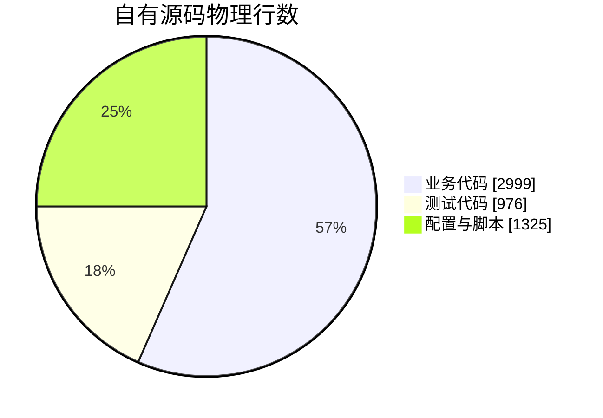
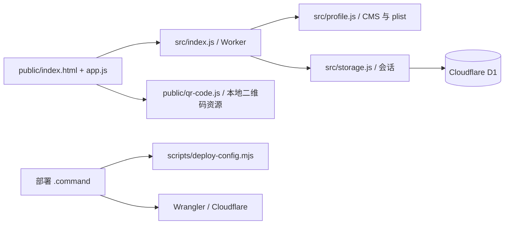
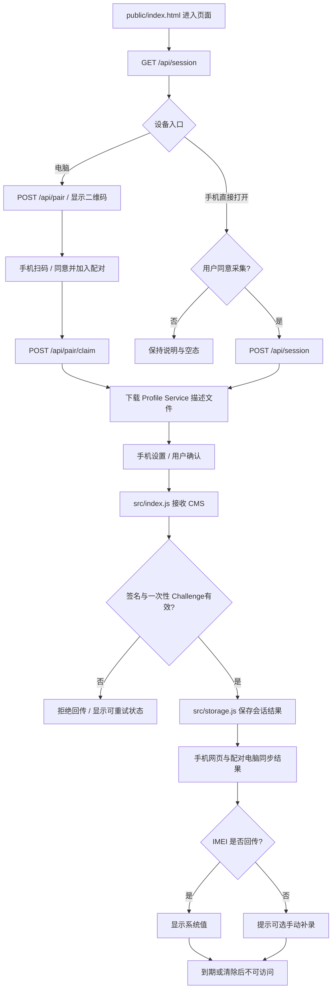

# JobsDeviceInfo


[toc]

## 🔥 <span id="前言">前言</span>

面向自己与已明确同意的设备使用者，通过网页引导 [**iPhone / iPad**](https://support.apple.com/zh-cn/102400) 确认设备信息描述文件，查看 UDID、系统返回的可选 IMEI 与基础设备信息。网页与后端一起运行在 [**Cloudflare Workers**](https://developers.cloudflare.com/workers/)，短期结果保存在独立 [**D1**](https://developers.cloudflare.com/d1/) 数据库。

维护者：Jobs。状态：可部署、持续维护。**真实手机回传需要在目标手机上确认描述文件；本机测试不能代替真机验收。**

**当前入口（2026-10-28）：[https://jobs-device-info-pages.pages.dev](https://jobs-device-info-pages.pages.dev/)。** [**Cloudflare Pages**](https://developers.cloudflare.com/pages/) 经内部绑定复用原 Worker 与 D1。用户已确认真机 UDID、IMEI 回传并在电脑显示结果；当前22项自动测试、75项真实本地HTTP/D1/CMS联调通过。十二项展示、文字点击复制、确认对话框、补录来源及390像素布局已用测试夹具检查。成功返回已调整为301绝对同源跳转，系统安装终态仍待新版真机复验；截图显示Wi-Fi，手机4G另验。

验收要求为**手机不开启 VPN 也能使用**。现有 `device.jobsgo.ccwu.cc` 与 `jobsdevices.ccwu.cc` 均未通过用户手机访问测试，电脑仅经代理可访问；该现象不能直接证明整个 `ccwu.cc` 后缀被阻断。用户没有其它域名或公网服务器，因此新增专属 Pages 默认域作为入口，不另购域名、不改套餐；原 Worker、D1 和域名绑定保留。跨域切换时需在当前 Pages 网站重新生成二维码；页面可达与系统回传成功分别验收。

| 能力 | 当前行为与入口 |
| --- | --- |
| 设备信息采集 | 手机打开线上 HTTPS 网站，同意本次采集后下载描述文件，进入系统设置确认，返回网页查看。 |
| UDID | 接收系统通过 Profile Service 返回的 UDID；普通网页无法直接读取。 |
| IMEI | 合法值展示，规范分组格式归一化；未返回或格式无法识别时明确提示，不保存异常原值，可手动补录并标记来源。**不承诺所有系统、机型返回 IMEI。** |
| 关于本机字段 | 显示IMEI、IMEI2、ICCID、MEID、系统版本、型号名称、序列号、型号号码和SEID；另保留UDID、产品标识和版本原始值。未回传项留空，不承诺全部自动取得。 |
| 结果操作 | 点击字段名称或数值复制并弹确认框；支持复制全部、补录缺失字段、清除会话。系统回传、手动填写和型号映射分别标明来源。 |
| 电脑与手机配对 | 电脑页面显示二维码，手机扫码打开线上站点，确认描述文件后，电脑同步显示收到的结果。 |
| 一键更新后端与网页 | 双击 [Worker 部署入口](<./【MacOS】🚀部署到Cloudflare.command>)，检查依赖和测试，复用专属数据库，再发布 Worker 与网页资源。 |
| Pages 入口 | 双击 [Pages 部署入口](<./【MacOS】🌐部署Pages入口.command>)，更新已存在的专属 Pages 薄入口，验证直连并更新本地预览地址与快捷方式；不重复发布后端。 |
| 本地预览 | 双击 [预览入口](<./【MacOS】🧪本地预览.command>)，仅启动本机服务与本地数据库。 |
| API 离线回退 | 请求失败或超时后展示明确标记的本地演示状态；恢复成功请求后自动切回服务端。演示状态不会生成假的描述文件。 |
| 隐私范围 | 每次会话 15 分钟，浏览器仅能访问自己的结果；不提供公开设备列表。 |

## 一、最快使用 <a href="#前言" style="font-size:17px; color:green;"><b>🔼</b></a> <a href="#🔚" style="font-size:17px; color:green;"><b>🔽</b></a>

当前已部署的采集站：[https://jobs-device-info-pages.pages.dev](https://jobs-device-info-pages.pages.dev/)。可双击本文件夹的 [打开线上采集站](./打开线上采集站.webloc)，在电脑生成新二维码后用手机扫码。以下步骤用于重新部署和维护；真实系统回传仍须在手机上验收。

1、打开 [部署配置](./deploy.settings.json)，核对 `account_id`、`worker_name`、`database_name` 与可选 `custom_domain`。当前默认 Worker 与数据库均为 `jobs-device-info`；不复用账户里的其它服务或 `JobsGo` 数据库。独立域名只填完整主机名，不含协议、路径、端口或通配符。

2、双击 `【MacOS】🚀部署到Cloudflare.command`。先阅读内置说明；**直接回车执行，任意字符后回车取消**。需要安装本项目依赖时会再说明来源并确认。已有健康依赖直接复用，不升级系统工具链。

使用 Pages 入口时，后端或网页源码更新仍先执行上述 Worker 部署，再运行 `【MacOS】🌐部署Pages入口.command`，恢复本地预览与快捷方式到 Pages 地址。Pages 入口只通过内部绑定转发请求，不复制运行另一份后端；只运行 Pages 脚本不会更新 Worker 中的业务源码或网页资源。完整条件与配置见 [Pages 说明](./pages/README.md)。

3、命令行 [**Wrangler**](https://developers.cloudflare.com/workers/wrangler/) 授权与浏览器登录独立。若未授权，脚本引导打开 Cloudflare 官方登录页，由你亲自审阅并确认。已授权时直接复用，不要求再次登录。

4、部署后脚本优先检查已安全绑定的独立域名；未配置时检查 `https://<worker>.<account-subdomain>.workers.dev`。选定线路的 `/api/health` 通过后显示并打开地址，写入本目录 `.deployment.json`；选择代理时会额外进行一次短时、不注入显式代理的本机检查。URL 以实际部署输出为准，发布与线路检查成功不代表手机 4G 已可访问。

5、在电脑页面扫描二维码，或在手机 [**Safari**](https://www.apple.com/safari/) 中直接打开该 HTTPS 地址。勾选采集说明，点击获取；允许下载后进入“设置 → 已下载描述文件”确认。配对模式下，系统回传后电脑页面会同步显示结果；直接在手机开始时回到原浏览器查看。**下载不等于安装，手机端必须手动确认。**

6、需要的项目未返回时，展开“补录关于本机信息”，在手机“设置 → 通用 → 关于本机”核对后填写。支持上述九项，标明手动来源；系统值只读，型号映射可更正。点击名称或数值复制，成功或失败均弹对话框；无值不复制假编号。

当前描述文件请求Apple官方已有示例的UDID、IMEI、ICCID、MEID、PRODUCT、VERSION、SERIAL。IMEI2、SEID、型号号码等仅在实际回传或手动补录时显示，不添加未经证实的属性。系统版本按Apple公开构建号与产品列表精确匹配时可自动推导，来源标记版本映射；未知不猜测。系统版本与构建号分开，型号名称来自[本地有来源的映射](./data/README.md)时明确标记。

查看已收到结果时，用同一浏览器打开普通首页；不要点击生成新二维码，它会替换当前会话。`#start-pair`入口遇到已完成会话时先恢复结果，不自动删除它。

当前流程支持 Apple 的 Profile Service。**Android 浏览器不能使用这份描述文件采集 UDID / IMEI；本项目没有绕过手机系统权限的功能。**

## 二、环境、命令和部署范围 <a href="#前言" style="font-size:17px; color:green;"><b>🔼</b></a> <a href="#🔚" style="font-size:17px; color:green;"><b>🔽</b></a>

部署与预览脚本使用 [**macOS**](https://www.apple.com/macos/) 自带 `/bin/zsh`；需要 [**Node.js**](https://nodejs.org/) 22.13 或更高版本及其自带 [**npm**](https://www.npmjs.com/)，建议使用 24 LTS 或更新的受支持版本。测试使用 Node 内置 `node:sqlite`，旧的 22.0～22.12 不满足本项目要求。没有 Node/npm 时停止并给出官方安装入口，不自动修改 [**Homebrew**](https://brew.sh/)、系统代理或 Shell 配置。

如果没有在配置中填写账户 ID，部署脚本使用 [**fzf**](https://github.com/junegunn/fzf) 选择已授权账户；回车确认，Esc 取消，空选不部署。已填写账户 ID 时无需此选择器。脚本不静默改选其它账户。

| 入口 / 参数 | 实际作用 |
| --- | --- |
| 部署脚本，无参数 | 显示说明并等待回车；可安装本项目缺失依赖、登录、建库、迁移和发布。 |
| 部署脚本 `--help` | 本地说明，不安装、不联网、不写日志。 |
| 部署脚本 `--check` | 本地 Node/npm、模板和直接依赖版本检查；不访问 Cloudflare、不改文件。 |
| 部署脚本 `--deploy` | 明确执行已审阅的部署，可用于自动化；无交互时依赖缺失、授权缺失或首次同名 Worker 接管均停止。 |
| 预览脚本，无参数 | 确认后安装缺失项目依赖、迁移本地 D1，启动 `127.0.0.1:8787`。 |
| 预览脚本 `--help` / `--check` | 本地说明 / 只读检查，无安装、远程请求或日志写入。 |

自动化或不需要打开浏览器时，可在进程环境设置 `JOBS_DEVICE_NO_OPEN=1`；这只跳过完成后的浏览器打开，不跳过安装、登录、接管或部署检查。

健康检查与安全域名绑定 API 的网络方式由 `JOBS_DEVICE_HEALTH_NETWORK=direct|system-proxy` 控制。默认 `direct`，不注入本次显式代理；系统底层网络路由保持原样。双击且发现已启用的静态 HTTPS 系统代理时，用 fzf 选择“直连 / 使用当前系统代理”；没有静态代理则按直连继续。显式选择 `system-proxy` 时动态读取系统地址与端口，仅给对应单条 curl 传 `--proxy`，不固定端口、不导出全局代理变量、不修改系统设置。请求结束即停止使用；下次选择 `direct` 可撤回本次显式代理。PAC 或无效静态代理不猜测替代线路，明确报错。

代理线路检查成功后，额外的本机检查显式传入 `--proxy '' --noproxy '*'`，连接超时 3 秒、总超时 6 秒，并验证健康接口 JSON；`direct` 模式成功时直接复用本次检查，不重复请求。`.deployment.json` 的 `validation` 分别记录 `checkedVia`、`directWithoutExplicitProxy`、`mobileVerified` 与 `checkedAt`。未提供验证参数时，方式记为 `unknown`、本机无显式代理结果记为 `null`，不推断成功；手机验收始终独立标为 `false`。原有部署记录的其它有效字段会保留。选定线路成功时退出码仍为 0；额外本机检查失败会明确警告，不把“Cloudflare 发布完成”写成“手机网络可用”。

在本文件夹内运行：

```shell
zsh './【MacOS】🚀部署到Cloudflare.command' \
  --check

zsh './【MacOS】🚀部署到Cloudflare.command'

zsh './【MacOS】🧪本地预览.command'

npm test

npm run build
```

缺少项目依赖时，脚本从 `https://registry.npmjs.org/` 执行 `npm ci --ignore-scripts`，版本由已随包提供的 `package-lock.json` 锁定；仅写本文件夹的 `node_modules`，不全局安装 Wrangler，不放开所有依赖的安装脚本。原生工具不可运行时构建会停止，须先检查对应已锁定包，不能用全量批准安装脚本绕过问题。

部署配置来源为 `deploy.settings.json` 和 `wrangler.json`；最终审阅配置写入 `.deploy/wrangler.json`，其中源码、静态文件和迁移目录均相对于该配置正确定位。重复部署精确复用指定名称的 D1；迁移由 Wrangler 记录已应用版本。未发现本地匹配部署记录、但远端已有同名 Worker 时，需要交互核对并输入 `YES` 才允许更新，避免覆盖其它项目。首次确认远端不存在或明确接管后写入 `.deploy/pending-deployment.json`，仅当账户、Worker 和项目绝对目录均匹配时允许中断后的重试；该文件不代表健康检查或部署已经成功。

发布会产生公开 Worker URL，并应用每 15 分钟一次的过期数据清理任务。配置 `custom_domain` 时仅绑定该完整主机名，其所属 Cloudflare 区域必须已激活；由 Cloudflare 生成所需 DNS 与 TLS，不覆盖现有记录、其它 Worker 或原站点。脚本先上传不含域名自动覆盖行为的 Worker 配置副本，再通过 Cloudflare 变更预览拒绝冲突、移除或配置外域名；最终绑定请求始终关闭既有 DNS 与其它服务覆盖。访问令牌只从既有 Wrangler 授权读取到进程内存，通过 curl 标准输入传给官方 API，不写文件、命令参数或日志。不更改套餐或自动开启付费方案，资源使用受账户现有额度和计费规则约束。

健康检查通过后，部署工具还会写入 `public/public-site.json`，其中仅包含无参数的线上 HTTPS 根站 URL。点击本机预览里的线上配对入口时，页面转到这个线上站点并生成可被手机访问的二维码；电脑留在该线上页面等待结果。线上网站直接使用自身站点地址，首次部署无需为此再次发布；之后更新部署时该公开配置一并打包。配对链接的随机凭据放在 URL fragment，不把 UDID、IMEI、Cookie 或服务端凭据写入二维码。

## 三、采集、签名和保存边界 <a href="#前言" style="font-size:17px; color:green;"><b>🔼</b></a> <a href="#🔚" style="font-size:17px; color:green;"><b>🔽</b></a>

1、**网页不能静默读取 UDID / IMEI**。用户明确同意后，网站生成最小 Profile Service 描述文件，由手机系统在确认后把信息送回本站的 Cloudflare 服务。不会安装 MDM 管理、VPN、代理、根证书，也不读取通讯录、相册或定位。

2、下发的描述文件未使用站点签名证书进行 CMS 签名，手机可能显示“未签名”。这与回传签名是两件事：服务端要求设备回传 CMS 内容签名并校验其完整性。**目前没有验证签名者的 Apple 证书信任链，结果不能作为设备真实性、登录身份、支付或风控凭据。** 不要关闭 HTTPS 校验或绕过浏览器证书告警。

3、服务器仅保存白名单展示字段，不保存原始 CMS、证书和 XML。Cookie、回调 Token、Challenge 只以散列入库；一次回传后拒绝重放。直接采集结果需要当前浏览器的 HttpOnly Cookie；配对结果仅对发起配对的电脑会话与已加入的手机会话可见，配对凭据通过随机 fragment 传递。硬件编号不会进入地址查询参数或公开列表。

4、会话创建后 15 分钟逻辑过期，接口不再返回结果。接口访问会回收过期记录，后台每 15 分钟另行清理；无访问时物理回收通常在有效期后约 15 分钟触发，受平台调度影响。**清除当前记录不等于抹除 Cloudflare D1 的 Time Travel、备份或平台保留记录**；具体平台保留策略以 Cloudflare 为准。

5、每个 IP 每 15 分钟最多创建 12 个会话。服务器只记录短期随机盐处理的 IP 散列，原始 IP 不保存到本项目数据库。Cloudflare 平台本身的访问与安全日志受账户配置和平台策略控制，本项目默认关闭 Worker Observability。

6、IMEI 是可选回传字段。双卡机型可能有多个 IMEI，本项目展示此次系统返回的字段或你手工补录的一项，不能据此证明已枚举整台设备的全部蜂窝模块。`VERSION` 也可能是系统构建号，不能保证始终等于“关于本机”的公开版本号。

依据：[苹果 Profile Service 示例](https://developer.apple.com/library/archive/documentation/NetworkingInternet/Conceptual/iPhoneOTAConfiguration/ConfigurationProfileExamples/ConfigurationProfileExamples.html)、[描述文件安装说明](https://support.apple.com/zh-cn/102400)、[D1 Time Travel](https://developers.cloudflare.com/d1/reference/time-travel/)。归档示例不构成所有当前系统和机型返回 IMEI 的保证。

## 四、本地预览、网络回退与验证 <a href="#前言" style="font-size:17px; color:green;"><b>🔼</b></a> <a href="#🔚" style="font-size:17px; color:green;"><b>🔽</b></a>

预览脚本先由锁定依赖构建本地二维码资源，再用 `wrangler d1 migrations apply DB --local` 初始化 `.wrangler` 内的本地存储，启动 `wrangler dev --ip 127.0.0.1 --port 8787`。本地预览不会发布网站；Ctrl+C 停止。手机不能访问这台 Mac 的 `127.0.0.1`，真机采集须用部署后的 HTTPS 地址。本机页面读取已部署的公开站点配置，点击线上配对入口后转到线上页面；此后配对会话与结果保存在远程 D1。

页面进入与刷新始终请求真实 API。超时、失败或解码失败后保留页面并显示“演示数据”；演示中的复制、补录和清空仅影响浏览器本地演示状态。接口恢复后的成功响应自动覆盖为真实数据。演示不会触发假采集，不会把示例编号提交为真实设备结果。此工具以排版和 CSS 构图呈现，无运行时外链图片、字体或占位图片依赖。

服务运行后，可在另一个终端验证本地 HTTP、D1、CMS 回调和会话隔离：

```shell
node ./scripts/verify-local.mjs
```

此联调脚本只接受 `127.0.0.1` / `localhost`；会在本机创建明确的测试会话与临时自签名 CMS 样本，不收集真机硬件编号，不证明 Apple 证书信任或真实手机兼容性。单元测试、构建、线上健康检查与手机真机验收属于不同验证范围。

| 故障 | 处理方式 |
| --- | --- |
| Node/npm 缺失或版本过低 | 从 Node.js 官方安装 22.13+ 后重试，建议 24 LTS；脚本不升级系统工具链。 |
| 已登录浏览器，CLI 仍提示登录 | 完成 Wrangler 官方授权；浏览器登录不会自动产生 CLI 授权。 |
| Cloudflare 账户不匹配 | 核对 `deploy.settings.json` 与当前授权账户，脚本不会擅自换账户。 |
| 同名 Worker 没有部署记录 | 核对远端确属本项目，再在交互终端输入 `YES`；自动化模式停止。 |
| 描述文件只下载了，没有结果 | 在系统设置中确认安装，返回原浏览器；会话已过期则重新开始。 |
| 显示“未签名” | 下发描述文件没有站点签名；核对来源与内容后由你决定是否继续，不绕过 HTTPS 告警。 |
| UDID 收到但 IMEI 为空 | 当前系统或机型没有回传，按页面说明手动补录。 |
| 浏览器切到演示模式 | 检查 API 或重新加载；数据恢复后自动显示服务端响应。 |
| 域名绑定存在 DNS / 其它 Worker 冲突 | 脚本停止且不覆盖；核对配置，另选独立子域或由你在控制台处理。 |
| 电脑可访问，手机 4G 的 Safari 未能加载网页 | 先验证手机到域名的网络与 TLS 可达性；尚未进入描述文件授权。代理检查成功不能代替直连与手机验收，不承诺换 Cloudflare IP 或关闭 HTTP/3 即可修复。 |
| 发布完成但健康检查失败 | 检查 `.deploy/deployment.log`、本机网络与 Cloudflare TLS 状态；本次失败不会写成成功，已有成功记录保留，可按同目录待完成记录重试。 |

## 五、目录和接口 <a href="#前言" style="font-size:17px; color:green;"><b>🔼</b></a> <a href="#🔚" style="font-size:17px; color:green;"><b>🔽</b></a>

```text
JobsDeviceInfo/
├── 【MacOS】🚀部署到Cloudflare.command  双击部署入口
├── 【MacOS】🌐部署Pages入口.command     更新 Pages 访问入口
├── 【MacOS】🧪本地预览.command          双击本地预览入口
├── README.md                          使用与部署总览
├── deploy.settings.json               账户与资源名称，无凭据
├── wrangler.json                      Worker、本地 D1 与静态文件模板
├── package.json / package-lock.json    精确版本与锁文件
├── public/                            网页、样式与前端交互
├── src/                               Worker 路由、CMS / plist 与存储
├── pages/                             Pages 薄入口与专用配置
├── data/                              型号映射、来源及MIT许可证
├── migrations/                        D1 结构迁移
├── tests/                             服务端安全与协议单元测试
└── scripts/                           配置生成与本地联调工具
```

目录说明：[网页](./public/README.md)、[服务端](./src/README.md)、[Pages 入口](./pages/README.md)、[部署和联调工具](./scripts/README.md)。`.deploy/`、`.build/`、`.pages-build/`、`.wrangler/`、`node_modules/`、`.deployment.json` 和 `.pages-deployment.json` 是忽略的本地状态，不包含在业务源码统计中。不要把 Cloudflare Token、Cookie、私钥或签名证书加入源码或压缩包。

| 方法与路径 | 输入 / 输出 |
| --- | --- |
| `GET /api/health` | 服务与会话表健康检查；`ok` 与 `service` 标识。 |
| `POST /api/session` | `{ "consent": true }`；设置 HttpOnly Cookie，返回当前会话与描述文件入口。 |
| `POST /api/pair` | 创建电脑端配对会话，返回一次性随机配对凭据；电脑会话本身不能下载手机描述文件。 |
| `POST /api/pair/claim` | 手机提交 `{ "token": "随机配对凭据", "consent": true }`，一次性加入电脑端会话并取得自己的 Cookie。 |
| `GET /api/session` | 返回自己的会话状态、到期时间与设备字段；无会话为 `session: null`。 |
| `GET /profile.mobileconfig` | 当前 Cookie 对应的 Profile Service 描述文件。 |
| `POST /api/profile/<token>` | 系统CMS签名回传；成功后301返回绝对同源首页，URL不携带设备编号。 |
| `POST /api/session/imei` | `{ "imei": "15位数字" }`；补录当前会话并标记 `manual` 来源。 |
| `POST /api/session/details` | `{ "fields": { "imei2": "…" } }`；九项白名单补录，不能覆盖系统值或修改UDID。 |
| `DELETE /api/session` | 删除自己的当前会话并清除 Cookie。 |

## 六、工程规模和依赖 <a href="#前言" style="font-size:17px; color:green;"><b>🔼</b></a> <a href="#🔚" style="font-size:17px; color:green;"><b>🔽</b></a>

统计日期：2026-10-28。依据当前 `public/index.html`、`src/index.js`、`migrations/*.sql`、`wrangler.json`、`package.json` 与锁文件；业务规模按路由条目和 HTTP 方法 / 路径组合统计，弹层与静态文件不另计页面，健康检查不计业务接口。

| 项目 | 规模与口径 |
| --- | --- |
| Web 页面 | 首页 1 个，业务子页面 0 个；页面路由 1 个。 |
| 对外业务 HTTP 接口 | 9个，见上表除`/api/health`外的条目；无RPC/MQ。 |
| 部署单元 | 1 个采集 Worker 与 1 个 Pages 薄入口；数据库和业务仅运行一份。 |
| 核心业务表 | 1 张 `sessions`；`rate_salts`、`rate_limits` 为短期限流辅助表。 |
| 业务状态机 | 1 个会话：直接创建或电脑配对 → 手机加入 → 等待 → 已收到 → 到期 / 删除。 |
| 外部系统 | Cloudflare D1 存储、Apple Profile Service 回调；无支付、短信、地图或第三方分析。 |
| 定时任务 | 1 个 Cron，每 15 分钟清理过期会话及限流记录。 |
| 运行时规模 | 自托管工具，尚未建立峰值 QPS、日增量或容量承诺；以账户实际额度为限。 |
| 建库与提交 | 当前文件夹不是 Git 仓库，无首次提交、提交总数或贡献者统计；未创建提交或推送。 |

工具链与依赖版本由 `package.json` 和 `package-lock.json` 固定，锁文件随交付文件夹提供；Node.js 最低 22.13。页面使用浏览器原生能力，无前端框架，真机浏览器支持范围仍需目标 iOS / iPadOS 验收。

| 直接依赖 | 锁定版本 | 来源 / 许可证 | 用途 |
| --- | --- | --- | --- |
| [**ASN1js**](https://github.com/PeculiarVentures/ASN1.js) | 4.0.0 | npm 公库 / BSD-3-Clause | 解析 CMS ASN.1。 |
| [**PKIjs**](https://github.com/PeculiarVentures/PKI.js) | 4.0.1 | npm 公库 / BSD-3-Clause | 校验 CMS 内容签名；不代表已校验 Apple 信任链。 |
| [**fast-xml-parser**](https://github.com/NaturalIntelligence/fast-xml-parser) | 5.11.2 | npm 公库 / MIT | 严格处理 plist XML。 |
| Wrangler | 4.154.0 | npm 公库 / MIT OR Apache-2.0 | 本地运行、D1 迁移、部署。 |
| [**node-qrcode**](https://github.com/soldair/node-qrcode) | 1.5.4 | npm 公库 / MIT | 在浏览器本地生成配对二维码，不调用第三方二维码服务。 |
| [**esbuild**](https://esbuild.github.io/) | 0.28.2 | npm 公库 / MIT | 构建随项目打包的二维码模块。 |
| [**jsQR**](https://github.com/cozmo/jsQR) | 1.4.0 | npm 公库 / Apache-2.0 | 独立解码生成的二维码，用于验证内容正确。 |

直接依赖均使用精确版本，传递依赖以锁文件为准；无私有依赖。许可证依据对应安装包的 `package.json`。这里不把“未专门进行全量供应链漏洞审计”表述成“没有漏洞”。

源码统计按文件与物理行计算，包含注释、空行，日期同上。业务代码为 `src/*.js`、`pages/worker.js`、`public/index.html` / `app.js` / `styles.css` 与数据库 SQL；测试单列；配置与脚本包括根配置和部署 / 构建工具。排除第三方 `node_modules`、生成的 `public/qr-code.js`、`public/public-site.json`、锁文件、第三方型号映射资料、说明文档、许可证文本、隐藏运行目录和构建产物。下表占比只在三类自有源码间计算，四舍五入可能产生 0.1% 误差。

| 类别 | 文件数 | 物理行 | 行数占比 |
| --- | --- | --- | --- |
| 业务代码 | 11 | 2999 | 56.6% |
| 测试代码 | 3 | 976 | 18.4% |
| 配置与脚本 | 12 | 1325 | 25.0% |
| 第三方与生成资源 | 排除 | 排除 | 不计入分母 |



功能覆盖：HTTPS、Cookie 会话隔离、同源写入校验、CMS 签名完整性、一次性回调和限流已实现；无证书绑定、JWT、设备身份认证、相机、蓝牙、推送、定位、支付或第三方埋点。数据库迁移由 Wrangler 管理；前端支持系统深浅色与中文界面，网络失败使用显式演示状态。

模块依赖与核心流程保留为可编辑 [**Mermaid**](https://mermaid.js.org) 源码：





## 七、日志和配置撤回 <a href="#前言" style="font-size:17px; color:green;"><b>🔼</b></a> <a href="#🔚" style="font-size:17px; color:green;"><b>🔽</b></a>

双击脚本的日志位于系统临时目录，名称分别为 `【MacOS】🚀部署到Cloudflare.log`、`【MacOS】🧪本地预览.log`。运行时显示真实位置；日志为纯文本，过滤认证令牌、颜色和回调令牌。`.deploy/` 还保留本项目部署输出、数据库列表和健康检查结果，均不含 Cloudflare OAuth 凭据。

停止本地预览按 Ctrl+C。部署脚本不修改系统代理、Shell 初始化文件或全局 npm 包；单条 curl 使用的显式代理随请求结束停止。配置了独立域名时 Cloudflare 会管理该域名所需的 DNS 与 TLS；解绑在 Cloudflare 控制台精确选择本项目的独立域名，不操作原站点或其它记录。远端服务会继续运行；停止网站可在 Cloudflare 控制台精确选择 `jobs-device-info` Worker，数据库另行按需要处理。删除远端资源属于单独操作，本工具不会自动删除其它资源或执行清库。

<a id="🔚" href="#前言" style="font-size:17px; color:green; font-weight:bold;">我是有底线的➤点我回到首页</a>
